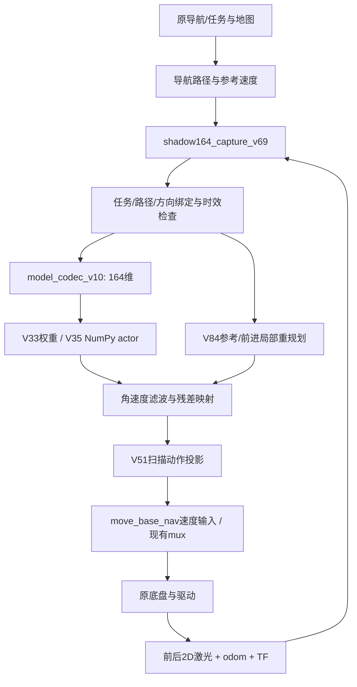

# 结合本车的运行流程

## 在线链路

这张图描述仓库的历史真机V85链路。仿真V94使用V93参考规划与V90投影，V95是实验参考规划；这几者不能默默替换成“同一部署实现”。

## 一次导航的时序

1. 原系统下发前进路径，原导航正常运行。PPO不以持续发布零速占住日常行驶通道。
2. 固定障碍使原系统遇障停稳。接管门槛检查任务唯一、方向、输入新鲜、原参考归零、实测停稳等条件。
3. 历史V85的运动模式在WAIT_CONFIRM状态可自动确认接管；不加`--enable-motion`则不建立速度发布器。单独类ManualTakeoverGate的名字不表示运行时必须每趟手动确认，须看适配器集成逻辑。
4. 局部参考与PPO动作共同给出候选速度；扫描记忆和车体净空投影限制动作。无路时停止，当前范围不允许倒车脱困。
5. 绕过障碍后，满足路径对齐、原导航安全状态等交还条件，停止持有控制权，原导航继续到站。
6. 取消任务/遥控覆盖/输入过期分别有记录；控制权释放与发布零速不是同一个动作，不能在仍有导航任务时直接杀进程冒充安全交还。

## 是否只是“提高优先级”

不是只改一个优先级数。策略、参考控制器、残差限幅、扫描投影、接管状态机、mux控制权确认和交还共同决定行为。仓库不修改现场mux的原优先级表；部署前必须读取现车配置，确认`move_base_nav`、原导航、遥控/急停的优先级与超时关系。

## 记录问题

`runtime_data/decisions.jsonl`保存策略、实际指令、接管状态和原因；`runtime_data/trials/capture_*.jsonl.gz`按接管过程保存输入。在“碰撞/卡顿/不接管”时保留日志和障碍位置；记录任务方向、地图版本、箱尺寸与车边实际距离。不要仅用口头“卡住”决定调奖励。

## 分工边界

ROS原导航/底盘和硬急停属于原车系统；本仓库只提供叠加的局部绕障集成。没有相机识别模型、行人分类/轨迹预测，也没有任意动态人群避让的验收结果。
